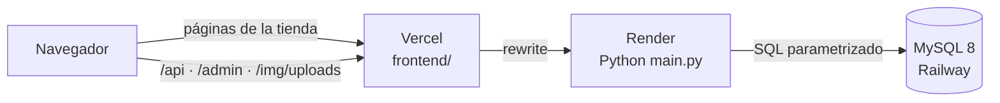

# Arquitectura · Purple One

> Los planos: con qué se construye y cómo se conectan las piezas.

## Visión general

Tres capas: cada una habla solo con la de al lado. El navegador siempre ve **un solo dominio** (el de Vercel). Vercel entrega la tienda y reenvía a Render todo lo que necesita servidor: la API, el panel y las imágenes subidas. Así la cookie de sesión funciona sin configurar CORS.

## Dónde corre cada cosa

| Pieza | Local | Nube |
|---|---|---|
| Tienda (12 páginas HTML) | `python main.py` → http://127.0.0.1:8000 | Vercel (`outputDirectory: frontend`) |
| API `/api/*` | mismo proceso | Render (`render.yaml` → `python main.py`) |
| Panel `/admin/*` (23 páginas) | mismo proceso | Render (Vercel lo excluye con `.vercelignore` y lo reenvía) |
| Base de datos | MySQL local | MySQL de Railway |
| Imágenes subidas desde el panel | `frontend/img/uploads/` | disco de Render (ver hallazgo A-03) |

## Front

- HTML5, CSS3 y JavaScript sin frameworks. Un HTML, un CSS y un JS por página; tokens en `frontend/css/global.css`.
- WebGL directo para la intro (`js/intro.js`), SVG para el avatar y las banderas.
- `fetch` a `/api/...` con `credentials: "same-origin"`. **No hay datos simulados en el navegador**: todo viene de la API real (se eliminaron `mock-api.js` y `mock-data.js`).

## Back

- Python 3 con `http.server` (librería estándar), 35 módulos en `backend/`. Rutas en `server.py`.
- Por dominio: `auth`, `security`, `users`, `products`, `cart`, `orders`, `payments_sim`, `currencies`, `rewards`, `bets`, `coins`, `progression`, `avatar`, `admin_*`.
- Sesión con cookie `HttpOnly` y token con hash en `auth_sessions`. Contraseñas con PBKDF2-SHA256.
- Única dependencia externa: `mysql-connector-python`.

### Variables de entorno (Render)

| Variable | Valor | Para qué |
|---|---|---|
| `PORT` | la pone Render | puerto donde escucha |
| `PURPLE1_HOST` | `0.0.0.0` | aceptar conexiones de fuera del contenedor |
| `PURPLE1_DB_HOST`, `_PORT`, `_USER`, `_PASSWORD`, `_NAME` | los de la conexión pública de MySQL en Railway | conexión a la base |
| `PURPLE1_ALLOWED_ORIGINS` | `purple1-seven.vercel.app` | aceptar POST que vienen del dominio de Vercel |
| `PURPLE1_TRUST_PROXY` | `1` | leer la IP real del cliente (límite de intentos de login) |
| `PURPLE1_COOKIE_SECURE` | `1` | cookie solo por HTTPS |

## Datos

- 33 tablas. Modelo, reglas y dueño de cada fila: [datos/modelo.md](datos/modelo.md).
- Contrato de cada operación: [contratos/api.md](contratos/api.md).
- Las reglas que protegen dinero y datos ajenos están **en la base** (`UNIQUE`, `CHECK`, claves foráneas) **y en el servidor** (sesión, transacciones con `FOR UPDATE`).

## Comparación con la arquitectura de referencia del diplomado

| Capa | Referencia (U4) | Purple One | Equivalencia |
|---|---|---|---|
| Front | Next.js en Vercel | HTML/CSS/JS en Vercel | Misma responsabilidad, sin framework |
| Back | Supabase / Spring Boot | Python `http.server` en Render | API REST propia |
| Datos | Postgres (Supabase) o MySQL | MySQL 8 | La guía admite Spring Boot + MySQL |
| Autorización por fila | RLS | Filtro por `user_id` de la sesión en cada consulta | Equivalente en función (ver `decisiones.md`) |
| Migraciones | `supabase/migrations/` | `database/schema.sql` + `upgrade_NN_*.sql` | Equivalente |
| Datos semilla | `seed.sql` | `database/seed.sql` + `demo_data.sql` | Igual |

## Comparación con el esquema de clase (MVP)

| Esquema de clase | Purple One | Nota |
|---|---|---|
| Frontend → Backend → Base de datos | Front (Vercel) → API REST en Python (Render) → MySQL (Railway) | Mismas tres capas, conectadas por REST |
| Spring Boot + Auth + Spring Security | Python `http.server` + sesión con cookie + roles en `server.py` | El back decide quién entra y qué puede hacer |
| JDBC → Supabase (Postgres) | `mysql-connector-python` → MySQL | Misma idea: solo el back habla con la base |
| RLS ✗ | Sin RLS | Como el acceso a los datos pasa siempre por el back, la autorización vive en el servidor |
| GitHub: PR a `main` + GitHub Actions (CI/CD) | `.github/workflows/ci.yml` revisa cada push y PR | Vercel y Render publican solos al hacer push a `main` |
| Front en Vercel / AWS / Azure / GCP | Vercel | Igual |
| Back en Render / AWS / Azure / GCP | Render | Igual. Como Render solo ofrece Postgres administrado, la base MySQL está en Railway |
