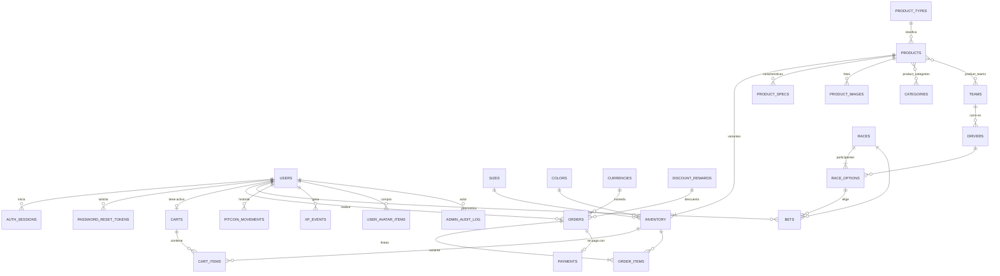

# Modelo de datos · Purple One

> Cimientos y estructura. Fuente de verdad del esquema: `database/schema.sql`.
> Motor: **MySQL 8** (no Supabase). Ver la decisión en `docs/decisiones.md`.

## 1. Entidades (los sustantivos de las specs)

| Dominio | Entidades | Tablas |
|---|---|---|
| Usuarios y acceso | usuario, sesión, token de recuperación, intento fallido | `users`, `auth_sessions`, `password_reset_tokens`, `auth_login_attempts` |
| Catálogo | producto, tipo, característica, categoría, equipo, imagen, talla, color, variante, banner | `products`, `product_types`, `product_specs`, `product_type_spec_templates`, `categories`, `product_categories`, `teams`, `product_teams`, `product_images`, `sizes`, `colors`, `inventory`, `banners` |
| Compra | carrito, ítem, pedido, línea, pago, moneda, descuento | `carts`, `cart_items`, `orders`, `order_items`, `payments`, `currencies`, `discount_rewards` |
| Carreras y economía | piloto, carrera, participante, pronóstico, movimiento de PitCoins, evento de XP, prenda comprada | `drivers`, `races`, `race_options`, `bets`, `pitcoin_movements`, `xp_events`, `user_avatar_items` |
| Administración | parámetro, registro de auditoría | `app_settings`, `admin_audit_log` |

Total: **33 tablas**.

## 2. Diagrama ER

## 3. Tablas principales

### users
| Campo | Tipo | ¿Nulo? | Regla |
|---|---|---|---|
| id | INT AUTO_INCREMENT | No | PK |
| email | VARCHAR(150) | No | UNIQUE |
| password_hash | VARCHAR | No | PBKDF2-SHA256, 600.000 iteraciones |
| first_name, last_name, phone, address | VARCHAR | Sí (teléfono y dirección) | — |
| coins | INT | No | CHECK `coins >= 0`; igual a la suma de `pitcoin_movements` |
| xp_total | INT | No | CHECK `xp_total >= 0` |
| is_staff, is_superadmin | BOOLEAN | No | CHECK: superadmin implica staff |
| is_active | BOOLEAN | No | nada se borra: se desactiva |
| avatar_config | TEXT (JSON) | Sí | validado contra el catálogo de `avatar.py` |

### orders
| Campo | Tipo | ¿Nulo? | Regla |
|---|---|---|---|
| id | INT | No | PK |
| user_id | INT | No | FK → users (RESTRICT) |
| status | VARCHAR | No | se crea `PAID` al aprobarse el pago |
| subtotal, total | DECIMAL | No | en EUR, los calcula el servidor |
| currency_code | CHAR(3) | No | FK → currencies |
| exchange_rate | DECIMAL | No | CHECK `> 0`; tasa del momento |
| total_local | DECIMAL | No | suma de los precios unitarios convertidos |
| discount_reward_id, discount_percent | INT | Sí / No | FK → discount_rewards; CHECK 0 a 20 |
| pitcoins_redeemed | INT | No | CHECK `>= 0` |

### bets (pronósticos)
| Campo | Tipo | ¿Nulo? | Regla |
|---|---|---|---|
| id | INT | No | PK |
| user_id, race_id, option_id | INT | No | FK; UNIQUE `(user_id, race_id)`; FK compuesta `(race_id, option_id)` → race_options |
| amount | INT | No | mínimo `pitcoins.min_bet` (servidor) |
| status | ENUM | No | `PENDING`, `WON`, `LOST`, `REFUNDED` |
| payout | INT | No | lo calcula `bets.compute_payouts` |

### races
| Campo | Tipo | ¿Nulo? | Regla |
|---|---|---|---|
| status | ENUM | No | `SCHEDULED`, `OPEN`, `LOCKED`, `FINISHED`, `CANCELLED` |
| race_date_utc, circuit_timezone | DATETIME, VARCHAR | Sí (juntos) | CHECK: ambos o ninguno |
| winner_option_id | INT | Sí | se fija al liquidar |

### pitcoin_movements
| Campo | Tipo | ¿Nulo? | Regla |
|---|---|---|---|
| user_id | INT | No | FK → users |
| kind | ENUM | No | `OPENING_BALANCE`, `BET_STAKE`, `BET_ADJUSTMENT`, `BET_PRIZE`, `BET_REFUND`, compra de prenda, ajuste del staff, recompensa por nivel, canje de descuento |
| amount | INT | No | CHECK `amount <> 0` (salvo saldo inicial) |
| balance_after | INT | No | CHECK `>= 0` |
| reference | VARCHAR | No | UNIQUE: un mismo hecho no se registra dos veces |

Las 33 tablas con todas sus columnas están en `database/schema.sql`.

## 4. Reglas de negocio → restricción y capa

| Regla de negocio | Dónde | Cómo |
|---|---|---|
| El saldo de PitCoins nunca es negativo | BD + servidor | CHECK `coins >= 0`; el servidor bloquea el saldo con `FOR UPDATE` antes de restar |
| Un usuario hace un solo pronóstico por carrera | BD + servidor | UNIQUE `(user_id, race_id)`; cambiarlo actualiza la misma fila |
| El piloto elegido pertenece a esa carrera | BD | FK compuesta `(race_id, option_id)` → `race_options(race_id, id)` |
| Un piloto no se repite en una carrera | BD | UNIQUE `(race_id, driver_id)` |
| No se pronostica después de la hora de salida | Servidor | `bets.place_bet` compara con `race_date_utc` bajo bloqueo |
| Pronóstico mínimo | Servidor | `pitcoins.min_bet` en `app_settings` |
| El stock nunca es negativo | BD + servidor | CHECK `stock >= 0`; el pago bloquea cada variante |
| Un solo carrito activo por usuario | BD | UNIQUE `uq_one_active_cart_per_user` |
| Una variante aparece una vez por carrito | BD | UNIQUE `(cart_id, inventory_id)`; CHECK `quantity > 0` |
| El precio y el total no los decide el cliente | Servidor | se leen de `products`/`inventory`/`currencies`; si la tasa vista cambió → 409 |
| Descuento máximo 20 % y uno por pedido | BD + servidor | CHECK en `discount_rewards`, `orders` y `app_settings` |
| Cada movimiento de PitCoins se registra una vez | BD | UNIQUE `pitcoin_movements.reference` |
| Superadmin implica staff | BD | CHECK `chk_users_superadmin_is_staff` |
| Siempre queda un administrador y un superadmin activo | Servidor | `admin_users.change_access` con bloqueo |
| Nada se borra físicamente | Servidor + BD | se desactiva (`is_active`); FK con `RESTRICT` en pedidos |
| La moneda base es EUR con tasa 1 | BD | CHECK `chk_currency_base` |

## 5. Dueño de cada fila (en lugar de RLS)

MySQL no tiene RLS. El servidor toma el usuario de la cookie de sesión y filtra por él.

| Tabla | Dueño | Quién la lee | Quién la cambia |
|---|---|---|---|
| users | el propio usuario | él mismo; staff | él mismo (perfil); superadmin (roles) |
| auth_sessions, password_reset_tokens | el usuario | solo el servidor | solo el servidor |
| carts, cart_items | el usuario | él mismo | él mismo |
| orders, order_items, payments | el usuario | él mismo; staff (solo lectura) | solo el servidor al pagar |
| bets | el usuario | él mismo; staff | él mismo mientras la carrera está abierta; el servidor al liquidar |
| pitcoin_movements, xp_events | el usuario | él mismo; superadmin | solo el servidor |
| user_avatar_items | el usuario | él mismo | él mismo (compra) |
| products, inventory, categories, teams, drivers, races, banners, currencies | la tienda | público (solo activos) | staff; monedas y descuentos solo superadmin |
| app_settings, admin_audit_log | la tienda | superadmin | superadmin; la auditoría solo la escribe el servidor |

Ranking público: solo nombre y PitCoins, nunca correo.

## 6. Migraciones y datos semilla

| Archivo | Para qué |
|---|---|
| `database/schema.sql` | Esquema completo (equivale a la migración inicial) |
| `database/upgrade_02` … `upgrade_09_*.sql` | Migraciones incrementales, una por fase |
| `database/seed.sql` | Configuración, catálogo base y datos oficiales de F1 2026 |
| `database/demo_data.sql` | Datos simulados de demostración (clientes ficticios, pedidos y pronósticos) |
| `database/purple1_completo.sql` | Copia completa para instalar; **no va a GitHub** |
